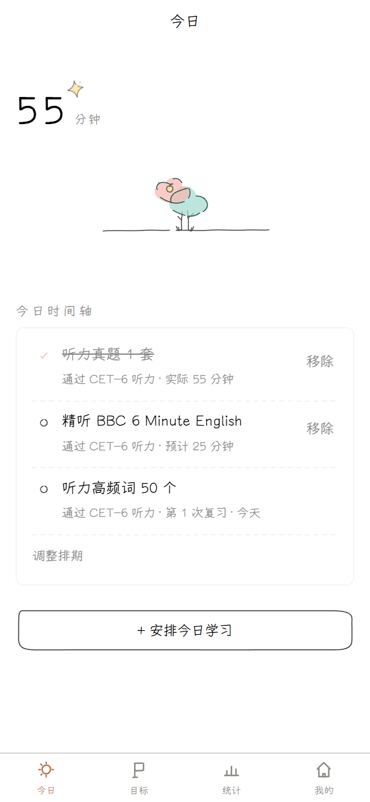
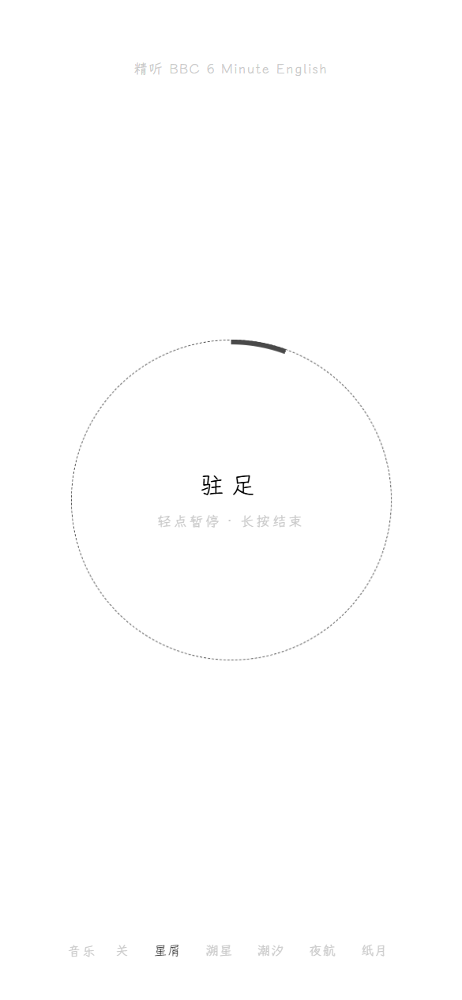
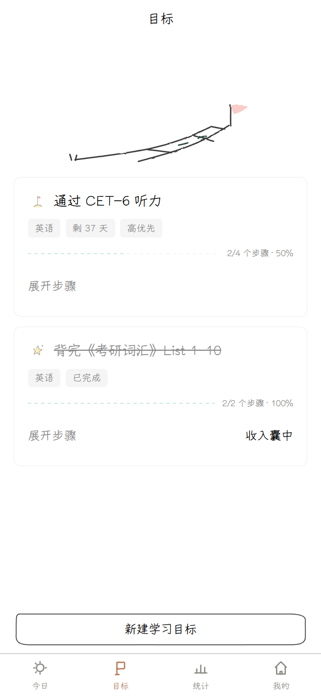
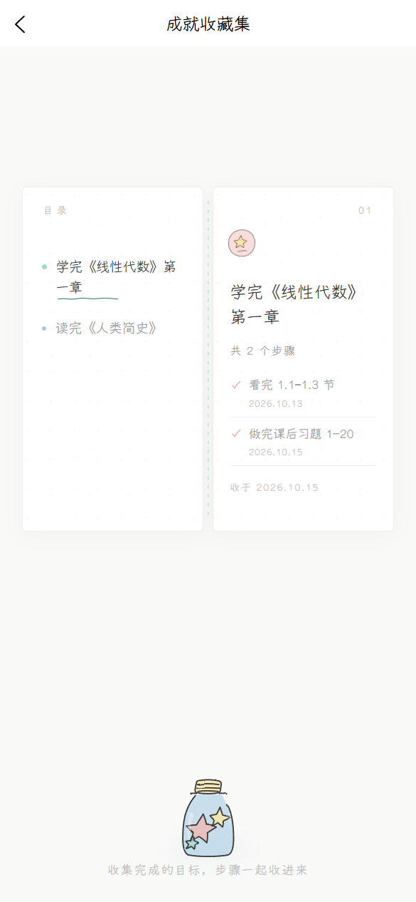
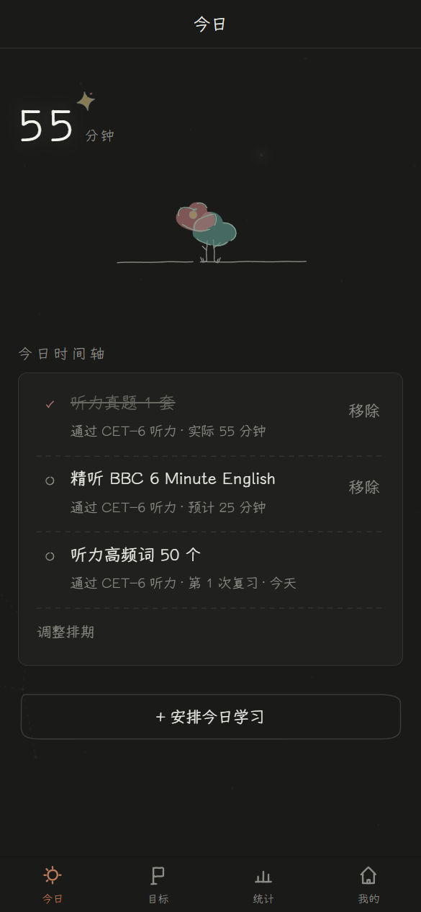

# 溯星（suxing-focus）

> 学习是一场不可避免的循环，如同巨石总会滚落山脚。  
> 但每次重新折返，每次写下新的计划，都是一次对抗引力的溯星。

**溯星**是一款完全**本地单机、无账号、不联网**的学习计划与专注计时应用，基于 `uni-app + Vue 3 + TypeScript` 构建。它采用手绘纸感与偏童话的视觉风格，去掉了打卡榜单、社交动态与弹窗催促，希望把屏幕留给安静的计划与专注本身。

---

## ✨ 设计特点

- **纯本地单机**：不登录、不上传，所有目标、步骤、每日计划与学习记录均保存在本机 `localStorage` 中；生产构建注入严格 CSP，测试中的离线护栏（`src/services/offline.spec.ts`）会阻止业务代码引入联网 API，Android 打包仅保留触感反馈权限。
- **手绘纸感与克制动画**：
  - 全站打包本地手写体「悠哉字体（Yozai）」与手绘 SVG 插画、手绘抖动边框（`HandFrame`）及波浪虚线（`HandLine`）。
  - 启动封面「溯星」字标按 22 笔笔顺逐笔写出，配以石升化星动画与离线渲染的背景音乐。
  - 深色模式并非简单黑白反转，而是暖调深灰底色搭配微光星座与「夜航星幕」。
- **不催促的陪伴感**：主页大树会随当天真实专注时长悄悄结出果子；完成今日任务时，屏幕上会轻轻绽放几缕线条烟花。

---

## 📱 主要功能

| 模块 | 说明 |
| :--- | :--- |
| **启动封面** | 开场三句引语、石升化星动画、逐笔书写字标与封面音乐开关 |
| **今日计划** | 今日专注分钟统计、大树成长、临近截止目标提醒、跨天旧安排处理、自动排期与手动挑选、完成线条烟花 |
| **全屏专注** | 顺时针闭合极简圆环、时间戳精确计时（支持重启自动暂停与恢复）、轻点驻足/复行、长按结束；内置 **星屑 / 溯星 / 潮汐 / 夜航 / 纸月** 五首本地循环音乐 |
| **目标管理** | 目标进度追踪、按目标标题关键词自动拆解四步学习计划（纯本地规则）、步骤优先级调整与手动排期 |
| **统计与收藏** | 今日/本周/连续天数/累计时长、近 7 天柱状图、目标投入分布、最近记录，以及手绘翻页绘本《成就收藏集》 |
| **我的设置** | 每日可学时长转轮（带轻震反馈）、每周可学习日、浅色/深色/跟随系统三态切换、使用指南与一键清空本地数据 |

---

## 🖼️ 界面预览

> 仓库内 `screenshots/` 目录已收录完整页面截图，可在浏览器打开 `screenshots/index.html` 集中浏览。

| 启动封面 | 今日（浅色） | 全屏专注 |
| :---: | :---: | :---: |
|  |  |  |

| 目标列表 | 成就收藏集 | 今日（深色夜航） |
| :---: | :---: | :---: |
|  |  |  |

---

## 📥 下载与随笔

- **Android 安装包**：前往 [Releases](https://github.com/kk-made/suxing-focus/releases) 下载最新 `suxing-1.0.3.apk` 直接安装使用。
- **创作随笔**：如果你想了解这个小软件背后的想法与制作过程，可以读一读 [《一场对抗引力的飞行》](STORY.md)。

---

## 🛠️ 技术栈

- **框架**：uni-app / Vue 3 / TypeScript / Vite
- **状态管理**：Pinia（搭配本地持久化插件 `src/stores/persist.ts`）
- **UI 组件**：`@dcloudio/uni-ui` + 自绘 SVG / Canvas 动效组件
- **单元测试**：Vitest

---

## 🚀 本地运行与构建

环境要求：**Node.js ≥ 18**、**npm ≥ 9**

```bash
# 安装依赖
npm install

# 启动 H5 本地开发调试
npm run dev:h5

# 构建 H5 生产产物（输出到 dist/build/h5）
npm run build:h5

# TypeScript 全量类型检查
npm run type-check

# 运行单元测试
npm test
```

> **提示**：专注页与封面的 `.wav` 背景音乐由 `scripts/render-focus-audio.cjs` 根据 `src/services/focusScores.ts` 中的五首编曲数据离线渲染到 `src/static/audio/`。若修改了编曲数据，需重新运行该脚本生成音频文件。

---

## 📂 目录结构

```text
suxing-focus/
├─ src/
│  ├─ pages/            # 启动封面、今日、专注、目标、排期、统计、成就收藏集、我的与指南
│  ├─ components/       # 手绘边框/分割线、大树场景、线条烟花、翻页收藏集、自定义 TabBar 等
│  ├─ stores/           # Pinia 状态模块（目标、任务、每日计划、学习记录、计时器、设置等）
│  ├─ services/         # 纯 TypeScript 业务逻辑与单元测试（排期、拆解、统计、大树、离线护栏等）
│  ├─ utils/            # 日期处理、本地存储封装、主题切换、音频与 ID 工具
│  ├─ styles/           # 浅色/深色设计 Token 与本地字体样式
│  └─ static/           # 本地字体分片、音频文件、Tab 图标与第三方许可
├─ scripts/             # 音频离线渲染与字标核验脚本
├─ screenshots/         # 各页面明暗双色预览截图
├─ STORY.md             # 创作随笔《一场对抗引力的飞行》
└─ package.json
```

---

## 📄 开源与第三方资源许可

- **全站字体「悠哉字体（Yozai）」**：基于 [lxgw/yozai-font](https://github.com/lxgw/yozai-font) 本地分片打包，遵循 **SIL Open Font License 1.1**（见 `src/static/fonts/yozai/OFL.txt`）。
- **「溯星」封面字标**：笔画中心线参考 [Make Me a Hanzi](https://github.com/skishore/makemeahanzi)（派生自 Arphic PL 字体）并重绘整理，遵循 **Arphic Public License**（见 `src/static/licenses/ARPHICPL.txt`）。
- **本项目代码**：采用 [MIT License](LICENSE) 开源。
